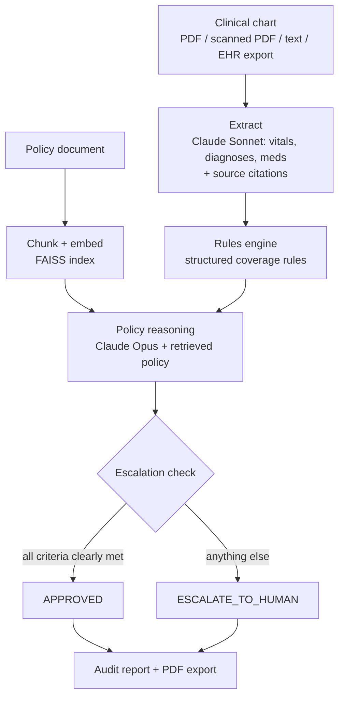

# Medical Chart Auditing Assistant

An AI-assisted tool that extracts structured clinical data from patient charts, cross-references it against insurance policy rules, and generates a traceable audit report for human review.

The system makes no final coverage decisions. Any case that does not fully and unambiguously meet all approval criteria is escalated to a human auditor.

## At a glance

| | |
|---|---|
| **Problem** | Chart audits require manually matching clinical evidence to insurance coverage rules |
| **What it does** | Extracts vitals, diagnoses, and medications with source citations; checks them against rules and policy via RAG; produces a traceable audit report |
| **How** | Claude Sonnet for extraction, Claude Opus for policy reasoning, FAISS retrieval, OCR for scanned charts |
| **Safety** | Mandatory escalation: any case not clearly meeting every criterion goes to a human auditor; every field anchored to source text |
| **Stack** | Python · Claude · OpenAI embeddings · FAISS · Tesseract OCR · Streamlit · fpdf2 · pytest |

---

## What it does

1. **Ingest** clinical documents — text-native PDFs, scanned PDFs (OCR), plain text, EHR exports
2. **Extract** structured clinical data — vitals, diagnoses, medications — with source citations and confidence scores
3. **Check** extracted data against structured coverage rules and an uploaded insurance policy document (RAG)
4. **Determine** `APPROVED`, `FLAGGED`, or `ESCALATE_TO_HUMAN` — with Claude's reasoning and cited policy excerpts
5. **Report** — unified two-column audit report with a downloadable PDF
6. **Log** — sidebar audit trail of every event in the session

---

## Requirements

- Python 3.11+
- [Tesseract OCR](https://github.com/tesseract-ocr/tesseract) (for scanned PDFs only)
- An Anthropic API key
- An OpenAI API key (used for policy document embeddings via `text-embedding-3-small`)

Install Tesseract on macOS:

```bash
brew install tesseract
```

---

## Setup

**1. Clone the repository**

```bash
git clone https://github.com/MisSwa/medical-chart-auditing-assistant.git
cd medical-chart-auditing-assistant
```

**2. Create and activate a virtual environment**

```bash
python -m venv .venv
source .venv/bin/activate
```

**3. Install dependencies**

```bash
pip install -r requirements.txt
```

**4. Set API keys**

Copy the example env file and fill in your keys:

```bash
cp .env.example .env
```

Edit `.env`:

```
ANTHROPIC_API_KEY=your_anthropic_key_here
OPENAI_API_KEY=your_openai_key_here
```

Both keys are required. The app will stop with a clear error at startup if either is missing.

---

## Running the app

```bash
streamlit run app.py
```

The app opens in your browser at `http://localhost:8501`.

---

## Workflow

1. **Upload a policy document** (PDF or TXT) — the policy is chunked, embedded, and indexed for retrieval
2. **Upload a clinical chart** (text-native PDF, scanned PDF, or plain text)
3. Click **Extract clinical data** — Claude extracts vitals, diagnoses, and medications with source citations
4. Click **Run policy check** — structured rules are evaluated, relevant policy chunks are retrieved, and Claude reasons to a determination
5. Review the **audit report** — two-column layout with extracted data on the left, determination and rule results on the right
6. Download the **PDF report** using the button at the bottom of the report
7. Check the **sidebar** for a live audit trail of all session events

---

## Running tests

Run all unit tests:

```bash
pytest -v
```

Skip the integration test (which makes a real OpenAI API call):

```bash
pytest -v -m "not integration"
```

Run a specific test file:

```bash
pytest tests/test_escalation.py -v
```

---

## Project structure

```
app.py                  Streamlit app — UI, session wiring, page layout
claude_client.py        Claude API integration for clinical data extraction
escalation.py           Escalation trigger — enforces human review rules
extractor.py            Document text extraction (PDF, OCR, plain text)
policy_reasoner.py      Claude policy reasoning — produces audit determination
policy_store.py         Policy document ingestion, chunking, FAISS index, RAG retrieval
report_builder.py       Assembles unified audit report dict from session data
report_exporter.py      PDF export via fpdf2
rules_engine.py         Structured coverage rule evaluation
session.py              Session state helpers and audit trail logging

tests/                  Unit and integration tests
spec/                   Phase specs — plan, requirements, validation per phase
uploads/                Uploaded documents (created at runtime, gitignored)
```

---

## Architecture



## Architecture notes

- **No persistent storage** — all state is held in Streamlit session state for the duration of a browser session. Uploaded files are written to `uploads/` during the session only.
- **Escalation is non-negotiable** — `escalation.py` runs after every policy determination. Any failing rule or non-APPROVED determination overrides the result to `ESCALATE_TO_HUMAN`. This cannot be bypassed.
- **Citation-grounded extraction** — every extracted field includes a `source_text` reference back to the document. No field is emitted without a document anchor.
- **Two AI models** — `claude-sonnet-4-6` for structured clinical extraction; `claude-opus-4-6` for nuanced policy reasoning
- **Embeddings** — `text-embedding-3-small` (OpenAI) for policy document retrieval; FAISS in-memory index built at upload time
